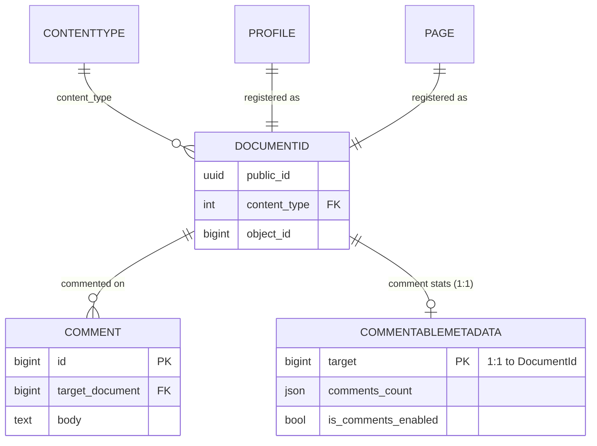

# Baseapp Core

This is the only required app in the baseapp-backend package. All other apps depend on it being installed and enabled in `INSTALLED_APPS`.

This app provides a set of shared features and extensible patterns, allowing the development of new apps and the maintenance of existing ones to focus only on their specific responsibilities.


## DocumentId Model

This is the most important model in the baseapp architecture. It acts as a database-level communication layer between models from different apps, helping reduce coupling across the system. In addition, it serves as a centralized model for registering the public IDs of all other models.

### How the decoupling works

Whenever we need to connect a model from one app to a model from another app, we create a generic foreign key pointing to the DocumentId model. Any model that should either allow other models to reference it or expose its ID to external apps such as the frontend must have a corresponding record in the DocumentId model. This ensures that the model is properly mapped and can participate in cross-app relationships.

Because this centralized model can grow to a large number of records, it is important to evaluate whether a model truly needs to be connected to DocumentId. In some cases, the model may already be reachable through existing foreign keys that are themselves mapped to DocumentId, making an additional mapping unnecessary.

Below is a database diagram illustrating the structure of the DocumentId model.



### Adapting your models

To connect your models to the DocumentId model, you simply need to extend the `baseapp_core.models.DocumentIdMixin` class in your model. This will automatically populate the corresponding DocumentId records via pgtriggers and will also provide a set of helper methods for internal use.

* `public_id`: Retrieves the public ID from the associated DocumentId record.
* `get_by_public_id`: Retrieves the corresponding model instance from a given public ID.


## HashIds

This feature introduces abstractions that allow projects to avoid exposing internal integer primary keys by using the DocumentId public_id as the unique identifier shared with external services, such as the frontend. Compared to sequential integer IDs, these public IDs make it significantly harder to infer other records, which is generally a safer and more appropriate approach than exposing raw database primary keys.

To make use of the HashIds feature, models, DRF endpoints, or Graphene operations must be made compatible by extending the required abstractions or by using the available helper functions.

For more details, see [Baseapp Core - HashIds](./hashids/README.md).

## N+1 detection (`baseapp_core.n_plus_one`)

An opt-in, dev-only app built on [django-zeal](https://github.com/taobojlen/django-zeal). It logs each lazy load that repeats per row, with the model, the field and the line that did it:

```
[zeal] [WARNING] N+1 detected on profiles.Profile.owner at /usr/src/app/apps/foo/graphql/object_types.py:42 in resolve_owner_email
```

The line points at project code or a BaseApp package, never at Django, zeal, pytest or a test. An N+1 with no such line, in test setup or inside a library such as wagtail, is reported at `<tests or third-party>`. Each distinct N+1 logs once per process, in the web and the Celery worker logs alike.

### Enabling it in dev

Install the `n_plus_one` extra (`baseapp-backend[n_plus_one]`), then in the dev settings only:

```python
import warnings

INSTALLED_APPS += ["zeal", "baseapp_core.n_plus_one"]
MIDDLEWARE = ["zeal.middleware.zeal_middleware"] + MIDDLEWARE
ZEAL_RAISE = False
# zeal's own warning is lost under Daphne; the app logs on the "zeal" logger instead.
warnings.filterwarnings("ignore", message=r"N\+1 detected", category=UserWarning)
```

Production settings never list it, so production never imports it or zeal.

### The test-suite scan

Load the pytest plugin from the project's root `conftest.py`:

```python
pytest_plugins = ["baseapp_core.n_plus_one.pytest_plugin"]
```

and silence the warnings in the pytest config (`filterwarnings = ignore:N\+1 detected:UserWarning`). When the test settings install the app (gate it behind an env var, as `testproject/settings.py` does with `NPLUSONE_REPORT=1`), every test runs inside a zeal context and the run ends with a report:

```
==================== N+1 report (zeal): 2 distinct ====================
[zeal] baseapp_core/models.py:142 in get_or_create_for_object  baseapp_core.DocumentId.get()  2469 hits, 149 tests
[zeal] baseapp_comments/signals.py:67 in _recompute_and_save_comments_count  comments.CommentableMetadata.get()  1667 hits, 107 tests
```

Nothing fails by default. To fail the tests that hit an N+1, add `-W "error:N+1 detected::baseapp_core.n_plus_one"`.

In this repository:

```bash
docker compose run --rm -e NPLUSONE_REPORT=1 web pytest baseapp_comments
```

zeal sees lazy loads and a `.get()` repeated from one line. It does not see other explicit per-row queries (`.filter().first()`, `.exists()`, `.count()` in a resolver) or N+1s in Channels consumers; query-count tests cover those.
